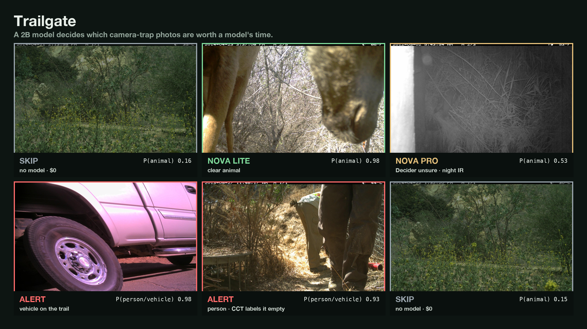
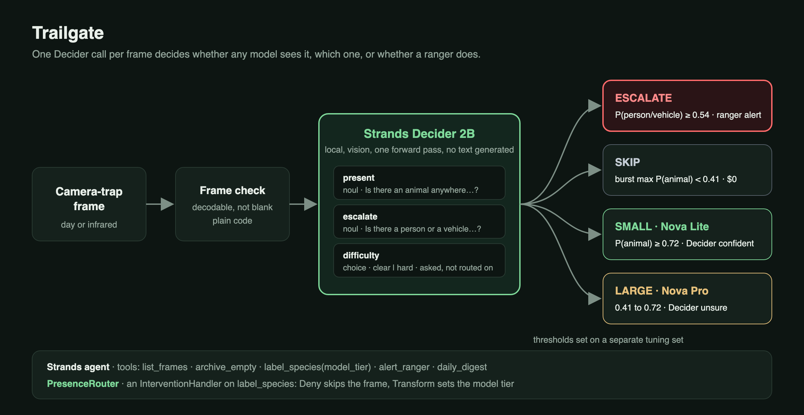
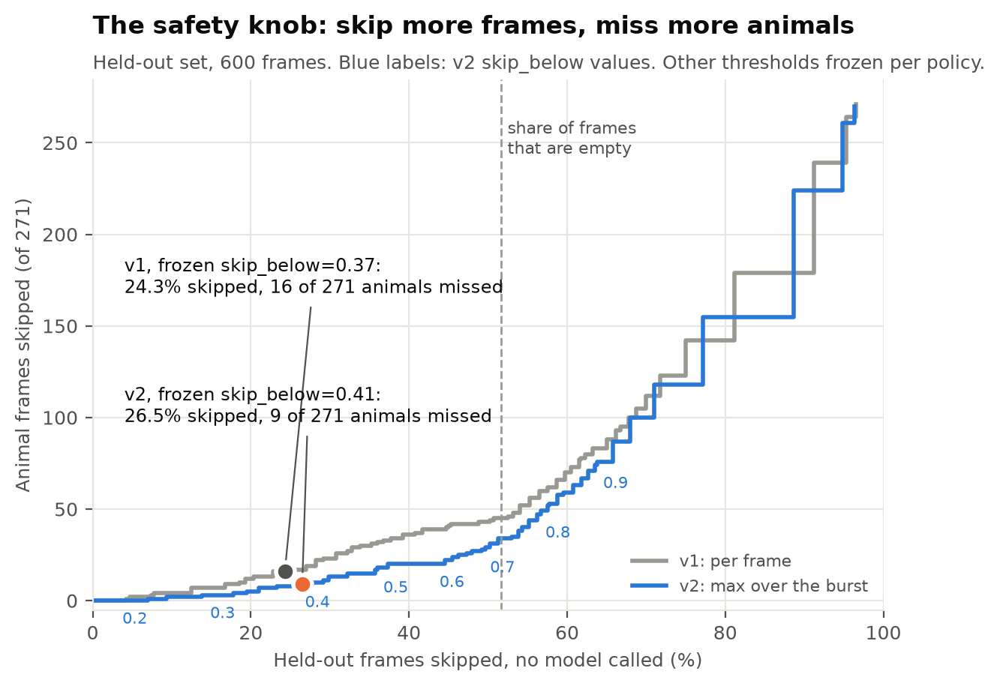

# Trailgate

**A 2B model decides which camera-trap photos need a vision model.** Trailgate skips empty frames without calling any model, sends animals to the right-sized Amazon Nova model, and hands a person or vehicle to the ranger.

Built for the AWS Builder Center *Agent Experience Hackathon: Strands Decider* ([project page](https://builder.aws.com/project/3L6f1pzmmKxbR582fuVZ8Fmzraw/trailgate-lets-a-2b-model-decide-which-camera-trap-photos-need-a-vision-model)). Tags: `#strands-decider-2b` `#model-routing`.

**Read the build story.** [Most camera-trap photos show nothing. I let a 2B model decide which ones a vision model sees](https://builder.aws.com/content/3L6iEoiyZZij0m5GmCDEIyg6kto/most-camera-trap-photos-show-nothing-i-let-a-2b-model-decide-which-ones-a-vision-model-sees), on AWS Builder Center.

**Try it in a browser.** https://trytrailgate.vercel.app replays real Decider answers on held-out frames in the ranger console. It's a static replay, and it shows Bedrock costs as estimates. To run Decider live you need the local setup below.



## The problem

Camera traps fire on anything that moves, including wind, grass and heat shimmer. The Caltech Camera Traps label file marks 125,745 of its 243,100 images empty, which is 51.7%. Someone has to sort those by hand, and a vehicle on a trail at night sits in the same pile as the grass.

Sending every frame to a vision model works, but you pay for every empty frame, and the cheapest model is the wrong one for a dark infrared shot.

## What Trailgate does

Every frame gets one call to Strands Decider 2B, running locally with its vision tower. Decider answers three typed questions about the same image in a single forward pass. Plain Python turns the probabilities into a route:

| Route | When | What happens | Cost |
|---|---|---|---|
| **Alert** | P(person or vehicle) ≥ 0.54 in any frame of the burst | Ranger alert naming the frame, written to the outbox and optionally sent through Amazon SNS. Nova writes the one-line note | Nova Lite + Nova Pro |
| **Skip** | max P(animal) over the burst < 0.41 | Archived. No model runs | $0 |
| **Nova Lite · Decider confident** | P(animal) ≥ 0.72 | Species label from the 21 CCT classes | Nova Lite |
| **Nova Pro · Decider unsure** | anything in between | Species label from the stronger model | Nova Pro |

These are the v2 thresholds. I set them on a separate tuning set from 13 camera locations and froze them before the held-out run. `results/thresholds.json` records the rule behind each value.



## The decision handed to Decider

The pattern tag is `#model-routing`. The question is "does this frame need a model at all, and if so, which one?", and the cheapest tier is no model. Two questions are `noul`, Decider's yes/no type, which returns P(true). `difficulty` is a `choice` between `clear` and `hard`. All three go in one call, so Decider encodes the image once.

```python
{
    "present": {
        "type": "noul",
        "instructions": "Is there an animal anywhere in this photo, even partly hidden or at the edge?",
        "criteria": {
            "true": "an animal or part of one is visible",
            "false": "only vegetation, ground, sky, or camera artefacts",
        },
    },
    "escalate": {
        "type": "noul",
        "instructions": "Is there a person or a vehicle in this photo?",
        "criteria": {
            "true": "a person, car, truck, motorbike or other vehicle, or part of one, is visible",
            "false": "only animals, vegetation, ground, sky, or camera artefacts",
        },
    },
    "difficulty": {
        "type": "choice",
        "instructions": "How easy is the subject to see?",
        "criteria": {
            "clear": "the subject is large, lit and in focus",
            "hard": "the subject is small, dark, blurred, infrared or partly hidden",
        },
    },
}
```

Take Decider out and the agent can't tell what to skip, which model to pay for, or when to wake a ranger. Every route in the table above comes from these probabilities.

## Results

The held-out set is 600 Caltech Camera Traps frames from 71 camera locations I never used for tuning. They come in their natural mix of 310 empty, 271 animal and 19 vehicle frames, plus 40 more vehicle frames. Decider answered every frame of each held-out burst, 1,079 frames, with one call per frame. Full tables are in [`results/metrics.md`](results/metrics.md).

| | Empty frames skipped | Animal frames missed | Vehicles caught | Decider latency p50 / p90 |
|---|---|---|---|---|
| **All** | **150/310 (48.4%)** | **9/271 (3.3%)** | **57/59** | 472 / 580 ms |
| Day | 118/228 (51.8%) | 5/112 (4.5%) | | |
| Night (infrared) | 32/82 (39.0%) | 4/159 (2.5%) | | |

- **The missed animals, checked by eye.** Of the 9 animal frames Trailgate skipped, 1 clearly shows an animal, a bird's tail in a corner. 4 show something faint like eye shine or a shape, and in 4 I can see nothing. Thumbnails are in [`results/missed.md`](results/missed.md).
- **Alerts.** 4 held-out frames without a `car` label raised an alert. 3 of them show people, and the dataset labels those `empty` because it has no person class, so those alerts are correct. 1 is a real false alert, a deer under a street lamp. The 2 missed vehicles are a dark dawn frame and a motion-blurred shape under a bridge.
- **Low confidence goes to Nova Pro.** When Decider gives P(animal) ≥ 0.9, the frame has an animal 171 times out of 172. Between 0.2 and 0.7 the scores track reality poorly, so that band goes to the stronger model. On the held-out set it held 165 of 600 frames.



The skip threshold is a safety knob. With v2 at 0.20, Trailgate misses no held-out animal and skips 5.2% of empty frames. At 0.50 it skips 63.5% of empty frames and misses 17 of 271 animal frames, or 6.3%. The frozen value, 0.41, came from the tuning set.

### Cost per 10,000 frames

| System | $ per 10,000 frames |
|---|---|
| Nova Pro on every frame | $16.03 |
| **Trailgate v2** (skip / Nova Lite / Nova Pro / alert) | **$5.55** |
| Trailgate v1 (difficulty-gated, superseded) | $10.27 |
| Nova Lite on every frame | $1.20 |

All Bedrock costs here are estimates. I took Bedrock on-demand prices for us-east-1 from the AWS Price List API and multiplied them by Nova's documented image token count for a 1024×747 frame, about 1,944 input tokens per call. I couldn't measure real Bedrock calls because the account's Nova quota was 0 during the hackathon. `scripts/run_nova_baseline.py` measures them, with species accuracy, on any account with Nova access, and `scripts/evaluate.py` merges the result. Decider I did measure, at 472 ms p50 and $0 per frame.

Trailgate costs 34.6% of Nova Pro on every frame and sends 26.5% of the sampled frames to no model. Those figures count one sampled frame per burst, because the dataset labels whole bursts. Over all 1,079 frames of the held-out bursts, 17.4% of frames reach no model. Trailgate skips 165 of 354 empty frames, or 46.6%, and 23 of 706 animal frames, or 3.3%.

It costs more than Nova Lite on every frame, and the reason is the 165 frames Decider is unsure about, which go to Nova Pro. If Nova Lite proves accurate enough on those frames, set `TRAILGATE_LARGE_MODEL` to Nova Lite. With the same token estimate that comes to about $0.93 per 10,000 frames, below Nova Lite on every frame.

### What changed between v1 and v2

| Policy | Empty frames skipped | Animal frames missed | $ per 10,000 |
|---|---|---|---|
| v1: Nova Pro whenever Decider calls the frame "hard" | 41.9% | 16/271 (5.9%) | $10.27 |
| v2 without bursts (ablation) | 49.0% | 23/271 (8.5%) | $5.10 |
| **v2: confidence band + burst context** | **48.4%** | **9/271 (3.3%)** | **$5.55** |

Two findings drove v2.

1. **The difficulty question carries little signal.** Decider called 504 of 600 frames "hard", including 192 of 271 animal frames. P(hard) separates night infrared frames from day frames with an AUC of only 0.67. v1 sent every "hard" frame to Nova Pro. v2 still asks the question, since a batched question is nearly free, but routes on Decider's confidence in P(animal) instead. I expected difficulty to carry the tier choice, and it didn't.
2. **Camera traps fire in bursts, and the dataset labels the burst.** 13 of v1's 16 misses were the second or third frame of a burst, often after the animal had left the frame. The burst rule in v2 skips a frame only if no frame in its burst scores above the threshold. That cut missed animal frames from 23 to 9 at the same thresholds.

I derived v2's threshold values again from the tuning set only. I chose the v2 policy itself after seeing where v1 failed on the held-out set, though, so v2's held-out numbers are a second look at frames I had already studied. The ablation row shows what each change does on its own.

### Question wording on the tuning set

Following Mike Chambers' method, I scored five wordings of the presence question in one batched Decider call per frame. The table is in [`results/wording.md`](results/wording.md). Adding explicit true/false criteria barely moved AUC, from 0.951 to 0.954, but it lifted the scores of real animals. At a 0.35 threshold, recall rose from 88.4% to 100%. Asking the same wording in a 9-question call and in the 3-question production call changed P(animal) by at most 0.004.

## Why each product

| Product | Role | Why it, measured |
|---|---|---|
| **Strands Decider 2B** | The routing decision on every frame | One forward pass, no text generated. p50 472 ms per frame on an Apple M5 laptop, $0 per call. Three questions about one image cost one encode. It returns probabilities, so the policy is a threshold set on labelled data, not a prompt. |
| **Amazon Bedrock, Nova Lite** | Species label when Decider is confident | 13× cheaper per input token than Nova Pro ($0.00006 vs $0.0008 per 1K) |
| **Amazon Bedrock, Nova Pro** | Species label when Decider is unsure | The stronger model goes only to the 165 of 600 frames in Decider's uncertain band |
| **Bedrock Converse API** | Image bytes in, structured JSON out | One call shape for both Nova tiers and the alert writer. The tier is a model id |
| **Strands Agents** | The ranger's agent, with `list_frames`, `archive_empty`, `label_species`, `alert_ranger`, `daily_digest` | `InterventionHandler` puts the decision in the tool path. `Deny` skips the frame before the model runs, `Transform` sets the tier |
| **Amazon SNS** (optional) | Ranger alert to a phone | Set `TRAILGATE_ALERT_TOPIC_ARN`. Alerts always land in `outbox/alerts.jsonl` too |

## Reuse it with `PresenceRouter`

[`patterns/presence_router/`](patterns/presence_router/) holds four files. `questions.py` builds the typed questions, `router.py` is a framework-free router with the confidence band and burst rule, `handler.py` is the Strands `InterventionHandler`, and `tune_questions.py` tunes wording and thresholds. It fits any agent that sends images to an expensive model. Change `target` to "a parcel or package", "a defect" or "a document".

```python
from strands import Agent
from patterns.presence_router import PresenceRouterCore, Thresholds
from patterns.presence_router.handler import PresenceRouter

router = PresenceRouter(
    PresenceRouterCore(target="a parcel or package", escalate=None, thresholds=Thresholds(skip_below=0.3)),
    tools={"describe_image"},
)
agent = Agent(tools=[describe_image], interventions=[router])
```

The handler fails open. If Decider errors, it returns `Transform` to the large tier and records the frame with a `decider_error`, and `on_error = "proceed"` covers anything else. A broken router costs money but never drops an image. [`examples/parcel_photos.py`](examples/parcel_photos.py) is a second agent built on it. The [pattern README](patterns/presence_router/README.md) explains how to set thresholds from about 50 of your own labelled images, how burst routing works, and where the pattern falls short.

## Limits

- Decider is zero-shot on images. These numbers hold for Caltech Camera Traps frames, so measure on your own cameras before you trust the thresholds.
- Night infrared is weaker. Trailgate skips 39.0% of empty night frames against 51.8% by day.
- The tuning set's zero-miss threshold missed animals on held-out cameras. Frame-level AUC was 0.954 on tuning and 0.900 on held-out.
- Decider stays confident on a blank image, so plain code checks that each frame decodes and isn't uniform before Decider sees it.
- The tuning set has only 5 person or vehicle frames. The vehicle numbers come from 59 held-out vehicle frames. The people numbers come only from frames the dataset mislabels as empty.
- Bedrock costs are estimates until `scripts/run_nova_baseline.py` runs on an account with Nova quota.
- The sets are small. Zero errors on a subset only means zero errors on those frames.

## Run it

You need Python 3.10+, an Apple Silicon Mac or a CUDA GPU for Decider, and AWS credentials with Bedrock Nova access for the labelling tiers.

```bash
uv venv -p 3.12 && uv pip install -e .
strands-decider serve StrandsAgents/strands-decider-2B-qwen3.5-v1-2610 --vision --device mps --port 8099

python scripts/fetch_cct.py                         # tuning, held-out and vehicle frames (seeded)
python scripts/fetch_bursts.py                      # the rest of each held-out burst
python -m trailgate run /path/to/card --digest                                   # triage a card, bursts grouped by EXIF time
python -m trailgate run --manifest data/heldout_bursts.csv --no-bedrock  # held-out bursts, Decider routing only
python -m trailgate agent "Process the card in /path/to/small/folder and tell me what needs me"
python -m trailgate.server                          # ranger console on http://127.0.0.1:8000
```

`--vision` runs on the PyTorch devices `mps`, `cuda` and `cpu`, not on MLX. Settings are environment variables, listed in `.env.example`. Export them in your shell, because nothing loads the file for you. The Strands agent routes one frame at a time, which matches the per-frame ablation row with 23/271 missed, and the cost tables leave out its own Bedrock model calls. The burst rule and the published numbers come from `python -m trailgate run`.

### Reproduce the numbers

```bash
python -m patterns.presence_router.tune_questions   # wording table on the tuning set
python scripts/freeze_thresholds.py                 # thresholds from the tuning set only
python scripts/evaluate.py                          # held-out metrics, sweep, bursts, cost
python scripts/evaluate.py --no-ask                 # same report from the committed Decider answers
python scripts/charts.py
python scripts/run_nova_baseline.py                 # Nova Lite and Nova Pro on every frame (needs Bedrock)
```

Every Decider answer behind these numbers sits in `results/decider_answers.jsonl` and `results/tune_answers*.jsonl`. `results/label_audit.csv` lists the frames I checked by eye.

## Repository

```
patterns/presence_router/   reusable decision pattern: questions, router, InterventionHandler, tuner
trailgate/                  pipeline, Bedrock layer, alerts, Strands agent, CLI, ranger console
examples/parcel_photos.py   the pattern in a second agent
scripts/                    data fetch, threshold freezing, evaluation, charts, Nova baseline
results/                    raw Decider answers, metrics, charts, missed-animal gallery, label audit
data/                       the exact frames in each split (images download to data/images/)
assets/                     cover image and architecture diagram
```

## Data and licence

The images and labels come from [Caltech Camera Traps](https://lila.science/datasets/caltech-camera-traps) by Beery et al., ECCV 2018, under the Community Data License Agreement, permissive variant. This repository doesn't store the images. `scripts/fetch_cct.py` downloads the exact frames listed in `data/`.

The code is Apache-2.0.
