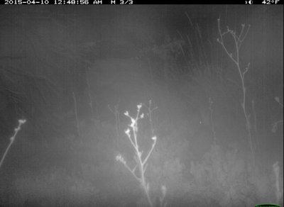
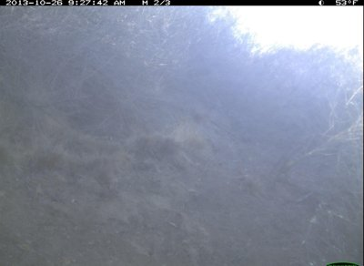
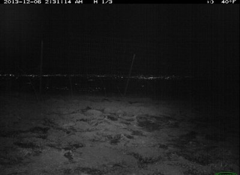
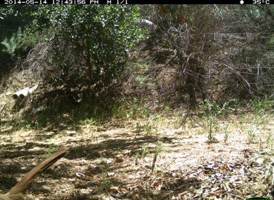

# Animal frames Trailgate v2 skipped (held-out)

"Visible to the eye" is a manual check of the full-size frame: yes, faint (a shape or eye shine that may be the animal), or no. Frame n/N is the frame's place in its camera burst (CCT `frame_num` / `seq_num_frames`).

| Thumbnail | Label | Lighting | P(animal) | Max P(animal) in burst | Frame | Visible to the eye | Note | File |
|---|---|---|---|---|---|---|---|---|
|  | rabbit | night_ir | 0.202 | 0.233 | 3/3 | faint | one eye-shine dot mid-right, night IR (burst 3/3) | `59a179a8-23d2-11e8-a6a3-ec086b02610b.jpg` |
|  | coyote | day | 0.213 | 0.256 | 2/3 | no | no animal visible to the eye (burst 2/3) | `58678c61-23d2-11e8-a6a3-ec086b02610b.jpg` |
|  | bird | day | 0.239 | 0.298 | 3/3 | faint | possible dark shape under the bush, centre right (burst 3/3) | `59260d4b-23d2-11e8-a6a3-ec086b02610b.jpg` |
|  | bird | day | 0.303 | 0.353 | 3/3 | no | no bird visible to the eye (burst 3/3) | `59af95eb-23d2-11e8-a6a3-ec086b02610b.jpg` |
|  | bird | day | 0.309 | 0.347 | 2/3 | no | fogged lens; no bird visible to the eye (burst 2/3) | `58cca688-23d2-11e8-a6a3-ec086b02610b.jpg` |
|  | coyote | night_ir | 0.329 | 0.329 | 1/1 | faint | eye shine and part of a body at the right edge, night IR (burst 1/1) | `597fecee-23d2-11e8-a6a3-ec086b02610b.jpg` |
|  | rabbit | night_ir | 0.353 | 0.355 | 2/3 | faint | small dark shape at the right, night IR (burst 2/3) | `5a1e5151-23d2-11e8-a6a3-ec086b02610b.jpg` |
|  | deer | night_ir | 0.378 | 0.378 | 1/3 | no | no deer visible to the eye, night IR (burst 1/3; the other two frames score 0.34 and 0.33) | `5949d0bd-23d2-11e8-a6a3-ec086b02610b.jpg` |
|  | bird | day | 0.395 | 0.395 | 1/1 | yes | a bird's tail fills the bottom-left corner (burst 1/1); missed by v2, P(animal) 0.395 | `5957c4f6-23d2-11e8-a6a3-ec086b02610b.jpg` |
