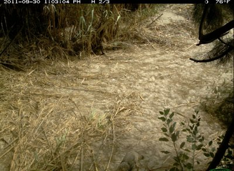

# Animal frames Trailgate skipped (held-out)

Every held-out frame labelled with an animal that the frozen router sent to `skip`.

"Visible to the eye" is a manual check of the full-size frame: yes, faint (a shape or eye shine that may be the animal), or no.

| Thumbnail | Label | Lighting | P(animal) | Visible to the eye | Note | Location | Frame |
|---|---|---|---|---|---|---|---|
|  | rabbit | night_ir | 0.202 | faint | one eye-shine dot mid-right, night IR (burst 3/3) | 61 | `59a179a8-23d2-11e8-a6a3-ec086b02610b.jpg` |
|  | coyote | day | 0.213 | no | no animal visible to the eye (burst 2/3) | 107 | `58678c61-23d2-11e8-a6a3-ec086b02610b.jpg` |
|  | bird | day | 0.239 | faint | possible dark shape under the bush, centre right (burst 3/3) | 87 | `59260d4b-23d2-11e8-a6a3-ec086b02610b.jpg` |
|  | rabbit | day | 0.244 | faint | possible dark shape in shadow mid-frame (burst 3/3) | 115 | `58c66358-23d2-11e8-a6a3-ec086b02610b.jpg` |
|  | fox | night_ir | 0.272 | faint | possible low shape left of centre, washed-out night IR (burst 2/3) | 55 | `597387f9-23d2-11e8-a6a3-ec086b02610b.jpg` |
|  | deer | night_ir | 0.277 | no | no animal visible to the eye, night IR (burst 1/3) | 84 | `58ec557f-23d2-11e8-a6a3-ec086b02610b.jpg` |
|  | deer | night_ir | 0.280 | faint | possible silhouette at the far left, very dark night IR (burst 2/3) | 117 | `58732f4c-23d2-11e8-a6a3-ec086b02610b.jpg` |
|  | bird | day | 0.303 | no | no bird visible to the eye (burst 3/3) | 3 | `59af95eb-23d2-11e8-a6a3-ec086b02610b.jpg` |
|  | bird | day | 0.309 | no | fogged lens; no bird visible to the eye (burst 2/3) | 94 | `58cca688-23d2-11e8-a6a3-ec086b02610b.jpg` |
|  | coyote | day | 0.313 | yes | coyote head and ears at the bottom edge (burst 2/3) | 46 | `5a0e37f2-23d2-11e8-a6a3-ec086b02610b.jpg` |
|  | squirrel | day | 0.323 | no | no squirrel visible to the eye (burst 2/3) | 78 | `58bd1d22-23d2-11e8-a6a3-ec086b02610b.jpg` |
|  | coyote | night_ir | 0.329 | faint | eye shine and part of a body at the right edge, night IR (burst 1/1) | 23 | `597fecee-23d2-11e8-a6a3-ec086b02610b.jpg` |
|  | squirrel | night_ir | 0.337 | no | no squirrel visible to the eye (burst 3/3) | 78 | `587d429b-23d2-11e8-a6a3-ec086b02610b.jpg` |
|  | rabbit | night_ir | 0.353 | faint | small dark shape at the right, night IR (burst 2/3) | 5 | `5a1e5151-23d2-11e8-a6a3-ec086b02610b.jpg` |
|  | cat | night_ir | 0.354 | faint | possible shape at the right, night IR (burst 1/3) | 78 | `58b2f0c0-23d2-11e8-a6a3-ec086b02610b.jpg` |
|  | bobcat | day | 0.356 | faint | part of an animal behind the concrete pillar, bottom left (burst 3/3) | 95 | `58d92faa-23d2-11e8-a6a3-ec086b02610b.jpg` |
